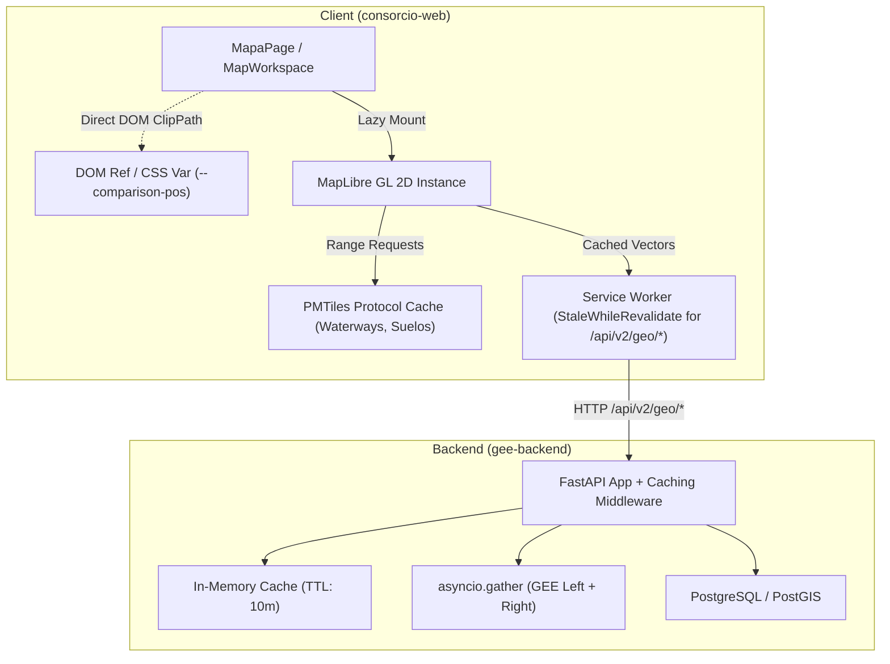

# Design: Map Performance, Network Latency & Render Loop Consolidation

## Architecture Diagram



## Detailed Technical Design

### 1. Network & API Optimization

#### 1.1 `useApprovedZones.ts` Separation
Split `useApprovedZones` into two distinct hooks:
- `useApprovedZones()`: only fetches `/api/v2/geo/basins/approved-zones/current`.
- `useApprovedZonesHistory()`: fetches `/api/v2/geo/basins/approved-zones/history`, used exclusively by `ApprovedZonesHistoryModal.tsx`.

#### 1.2 Parallel GEE Projections in `public_map.py`
In `gee-backend/app/domains/geo/public_map.py:380`:
```python
# Before:
left = await _project_setting_image(left_raw)
right = await _project_setting_image(right_raw)

# After:
left, right = await asyncio.gather(
    _project_setting_image(left_raw),
    _project_setting_image(right_raw),
)
```
In `consorcio-web/src/components/MapaMapLibre.tsx`:
Move `useImageComparisonListener()` out of the root render path of `MapaMapLibre.tsx`. Instead, mount it inside a conditional wrapper or pass an `enabled: viewMode === 'compare'` option to the hook.

#### 1.3 `vite.config.ts` Code Splitting Groups
Add a group for Tabler Icons in `rolldownOptions.output.codeSplitting.groups`:
```ts
{
  name: 'vendor-icons',
  test: /node_modules\/@tabler\/icons-react(\/|$)|src\/components\/ui\/icons/,
},
```

#### 1.4 Route Lazy Loading & Footer Suppression
In `routeTree.gen.tsx`:
```tsx
const mapaRoute = createRoute({
  path: '/mapa',
  component: () => (
    <RootLayout title="Mapa Interactivo" hideFooter={true}>
      <MapaPage />
    </RootLayout>
  ),
});
```
In `AdminDashboard.tsx`:
Convert `import { DashboardEstadisticas } from './management/DashboardEstadisticas';` to dynamic `lazy()`.

### 2. Geospatial & WebGL Layer Lifecycle

#### 2.1 PMTiles Waterways Integration
In `useWaterways.ts`:
Define PMTiles URLs instead of `.geojson` URLs:
```ts
export const WATERWAY_DEFS = [
  { id: 'rio_tercero', pmtiles: '/waterways/rio_tercero.pmtiles', ... },
  ...
];
```
In `mapLayerEffectHelpers.ts`:
Add vector source using `pmtiles://` protocol:
```ts
if (!map.getSource(sourceId)) {
  map.addSource(sourceId, {
    type: 'vector',
    url: `pmtiles://${window.location.origin}${def.pmtiles}`,
  });
  map.addLayer({
    id: layerId,
    type: 'line',
    source: sourceId,
    'source-layer': def.id,
    paint: { ... },
  });
}
```

#### 2.2 Lazy Mounting IDECOR Layers
In `idecorHydroLayers.ts`:
```ts
export function syncIdecorHydroLayers(
  map: MapLibreMap,
  visible: Readonly<Record<string, boolean | undefined>>
): void {
  if (!hasStyleApi(map)) return;
  for (const layer of IDECOR_HYDRO_LAYERS) {
    const isVisible = !!visible[layer.id];
    const sourceExists = !!map.getSource(layer.id);
    
    // Only register source & layers if visible or already present
    if (!isVisible && !sourceExists) continue;
    
    if (!sourceExists) {
      map.addSource(layer.id, { type: 'geojson', data: layer.geojsonUrl });
      // add layers...
    }
    setLayerVisibility(map, `${layer.id}-line`, isVisible);
    if (layer.kind === 'fill') setLayerVisibility(map, `${layer.id}-fill`, isVisible);
  }
}
```

#### 2.3 DEM Raster Tile Update (Fix Inversion)
In `mapRasterOverlayHelpers.ts`:
```ts
const source = existing as maplibregl.RasterTileSource;
if (source.setTiles) {
  source.setTiles([params.demTileUrl]);
  // adjust opacity & visibility
} else {
  removeRasterOverlay(map, SOURCE_IDS.DEM_RASTER);
  map.addSource(SOURCE_IDS.DEM_RASTER, { type: 'raster', tiles: [params.demTileUrl], ... });
}
```

### 3. React High-Frequency Event Decoupling

#### 3.1 Comparison Slider Direct DOM Ref
In `useComparisonSlider.ts`:
Store slider position in a ref `sliderPosRef.current`.
On `pointermove`:
Directly manipulate the overlay container's `clipPath` or update a CSS custom property:
`overlayElement.style.setProperty('--slider-pos', `${pct}%`)`.
Eliminate `sliderPosition` from React state in `MapaMapLibre.tsx`.

#### 3.2 Stabilizing `MapUiPanels` Memoization
In `MapaMapLibreView.tsx`:
Wrap inline control components (`toolsControl`, `placesControl`, `cursorReadout`) in `useMemo` anchored to their actual functional dependencies, and wrap inline event handlers with `useCallback`.
